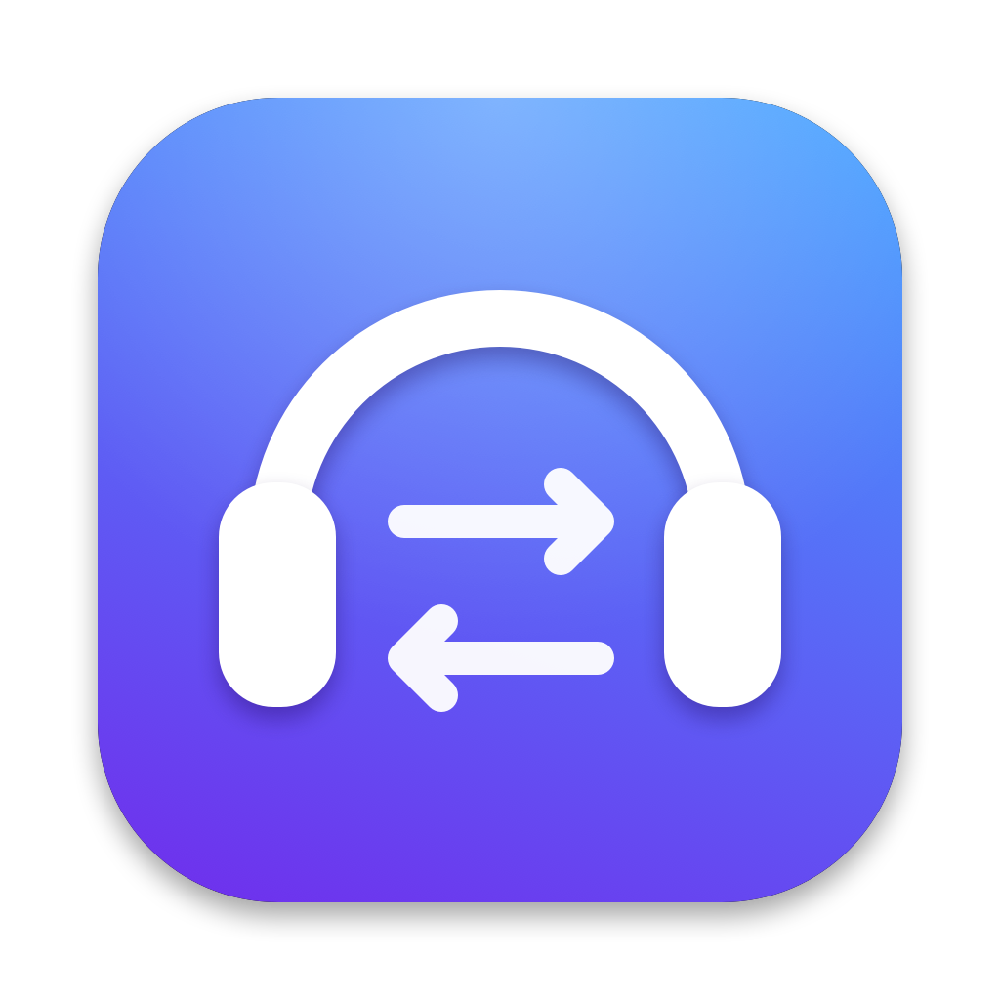

<div align="center">



# OutputSwitcher

**A menu bar sound switcher for macOS that tells your headphones apart.**

Per-device icons · real volume control · AirPods battery & listening mode · launch at login


</div>

---

## Why this exists

macOS shows the **same headphones glyph** for the headphone jack (`External Headphones`) and for **AirPods Max**.
When both are connected you cannot tell from the menu bar which one is actually playing, and a Multi-Output
workaround takes away the volume slider.

OutputSwitcher replaces the system Sound menu with one that:

- draws **its own icon per device**, so the active output is obvious at a glance,
- talks to the **real device** (no aggregate-device tricks), so volume and mute keep working,
- puts the AirPods extras (**battery, listening mode**) right under the device, like the original.

---

## Features

| | |
|---|---|
| 🎧 **Distinct device icons** | AirPods Max, AirPods Pro, the headphone jack, displays, HomePods, Mac models… each gets a fitting icon. The **menu bar icon follows the active output**. |
| 🎨 **Icon editor** | Pick any icon per device from a symbol grid, or type **any SF Symbol name**. Choices persist; "Automatic" restores the default. |
| 🔊 **Real volume & mute** | A native slider and mute button for the active device (uses the same *virtual main volume* the volume keys use). Stays in sync when you use the keyboard. |
| 🔁 **One-click switching** | Click an output to make it the default output *and* system output device. |
| 🔋 **Battery readout** | Percentage plus a battery glyph with an **exact fill level**: grey normally, **yellow below 30 %**, **red below 10 %**. |
| 🎚 **AirPods listening mode** | Off · Noise Cancellation · Transparency · Adaptive, in a **collapsible panel under the device** with the **real current mode checked** (needs [AirBuddy](#airpods-listening-mode-needs-airbuddy)). |
| 🚀 **Launch at login** | A toggle in the settings window, using Apple's login-item API (`SMAppService`). |
| 🧭 **Settings shortcuts** | `<device> Settings…` opens Bluetooth settings, `Sound Settings…` opens the Sound pane. The popover closes when they open. |
| 🪶 **Native & tiny** | Pure SwiftUI + CoreAudio, no third-party packages, menu bar only (no Dock icon). |

### What the popover looks like

```
┌──────────────────────────────────────┐
│ Sound                                │
│ 🔈 ───────────●────────── 🔊         │
│ ──────────────────────────────────── │
│ Output                               │
│  ◉  Mac Studio Speakers              │
│  ◉  External Headphones              │
│  ◉  LG UltraFine Display Audio       │
│  🔵 AirPods Max 2 DHF    97 % ▮▮▮▯  ⌄ │   ← active device (blue badge)
│   ┌──────────────────────────────┐   │
│   │ Listening Mode               │   │   ← collapsible, under the device
│   │   ◯  Off                     │   │
│   │ ✓ ☀  Transparency            │   │
│   │   ✦  Adaptive                │   │
│   │   ●  Noise Cancellation      │   │
│   └──────────────────────────────┘   │
│ ──────────────────────────────────── │
│ AirPods Max 2 DHF Settings…          │
│ Sound Settings…                      │
│ ──────────────────────────────────── │
│ OutputSwitcher Settings…             │
│ Quit OutputSwitcher                  │
└──────────────────────────────────────┘
```

---

## Requirements

| | |
|---|---|
| **macOS** | 26 or newer |
| **Toolchain** | Swift 6.2+ (Xcode 26 or the matching command line tools) |
| **Chip** | Builds for the chip of the Mac you build on (see [universal build](#universal-binary-intel--apple-silicon)) |
| **Optional** | [AirBuddy](https://airbuddy.app) running, for the AirPods listening-mode panel |

---

## Install

### Build from source (recommended)

```bash
git clone git@github.com:dhf/OutputSwitcher.git
cd OutputSwitcher
Scripts/bundle.sh
```

`Scripts/bundle.sh` builds a release binary and wraps it into **`OutputSwitcher.app`**: a menu-bar-only bundle
(`LSUIElement`), with the app icon, the permission descriptions macOS needs, and an ad-hoc code signature.

Then install it:

```bash
cp -R OutputSwitcher.app /Applications/ && open /Applications/OutputSwitcher.app
```

> Install **before** enabling *Launch at login*: the login item is tied to the app's location.
> After rebuilding, copy the new bundle over the old one.

### Replace the system Sound icon

1. Open **System Settings → Control Center → Sound** and choose **Don't Show in Menu Bar**
   (or Cmd-drag the system icon out of the menu bar).
2. Optionally open **OutputSwitcher Settings…** and enable **Launch OutputSwitcher at login**.

Hiding the system icon does not affect audio; the volume keys and Control Center keep working.

### Install on a second Mac

You do not need Apple's paid signing for your own machines:

- **Build there** with the commands above. A locally built app is never quarantined, so Gatekeeper stays quiet.
- **Or copy the finished app** over a channel that does not tag files as downloaded (USB, `scp`, `rsync`):

  ```bash
  rsync -a /Applications/OutputSwitcher.app othermac.local:/Applications/
  ```

  If it was copied via AirDrop or a browser, clear the quarantine flag:

  ```bash
  xattr -dr com.apple.quarantine /Applications/OutputSwitcher.app
  ```

macOS asks for Bluetooth and Automation permission once on every Mac.

---

## Using it

### Menu bar icon
The icon always shows the **active output device** and gets a slash when muted.
Click it to open the popover.

### Switching outputs
Click any row. The active device has the blue badge. Built-in outputs show the Mac model
(e.g. Mac Studio), Bluetooth headphones show their product icon.

### Volume
The slider and mute button act on the active device. Dragging the slider while muted unmutes.

### AirPods options
When the active output is a Bluetooth headset **and AirBuddy is running**, its row gets a chevron
(› collapsed, ⌄ expanded). Expand it for the listening modes; the checkmark reflects the **real**
current mode, refreshed every 10 seconds while the popover is open and one second after you change it.

### OutputSwitcher Settings
Open it from the popover (**OutputSwitcher Settings…**):

- **Launch OutputSwitcher at login** - registers the app as a login item. If macOS needs approval, a hint and a
  button to *Login Items* settings appear; errors are shown inline.
- **Device Icons** - every connected output with a **Change…** button: a grid of symbols, a field for any
  SF Symbol name (invalid names are rejected), and **Automatic** to reset.
  Devices appear while connected (AirPods once they are in use).

---

## Permissions

| Prompt | Why | If you decline |
|---|---|---|
| **Bluetooth** | Reads the battery level of connected Bluetooth headphones | No battery readout; everything else works |
| **Automation → AirBuddyHelper** | Reads/sets the AirPods listening mode through AirBuddy | No listening-mode panel; everything else works |

The app has **no network access, no analytics, and stores nothing except** your icon choices
(in the app's `UserDefaults`).

---

## AirPods listening mode (needs AirBuddy)

Apple provides **no public API** to read or change AirPods listening modes. The system menu uses a private
daemon (`AudioAccessoryServices`) that requires an **Apple-only entitlement** (`com.apple.AudioAccessoryServices`),
which third-party apps cannot obtain.
Several other routes were tried and ruled out during development:

| Route | Outcome |
|---|---|
| Private `IOBluetoothDevice.setListeningMode:` | Accepted, but only changes a cached value - the AirPods do not react |
| `AVOutputDevice` listening-mode API | The routing contexts expose no devices to call it on |
| `AADeviceManager.sendDeviceConfig:` | Blocked: `Missing entitlement 'com.apple.AudioAccessoryServices'` |
| Raw AAP over L2CAP (PSM `0x1001`) | Channel never opens - macOS already owns it |
| **AirBuddy's AppleScript interface** | ✅ **Works** - reads the live mode and sets any supported mode |

So OutputSwitcher drives **AirBuddy's helper** (`codes.rambo.AirBuddyHelper`, which ships an AppleScript
dictionary with `listening mode`, `supported listening modes` and `set listening mode`):

```applescript
tell application id "codes.rambo.AirBuddyHelper"
    set d to current output device
    set listening mode noise cancellation device d
end tell
```

Without AirBuddy the listening-mode panel simply does not appear. OutputSwitcher is **not affiliated with AirBuddy**.

**Not included:** Conversation Awareness (not exposed by AirBuddy's scripting interface) and Spatial Audio
(it exists in the interface but is unavailable on many devices).

---

## How it works

```
                  ┌──────────────────────────┐
  CoreAudio  ───▶ │   AudioDeviceManager     │ ───▶  SwiftUI views
  (devices,       │  (@Observable, @MainActor)│        MenuBarExtra popover
   default out,   │                          │        Settings window
   volume, mute)  │  ┌────────────────────┐  │
                  │  │ IconStore          │  │ ◀── UserDefaults
  IOBluetooth ──▶ │  │ BluetoothBattery   │  │
  (battery)       │  │ AirBuddyBridge     │  │ ◀── AppleScript → AirBuddyHelper
                  │  │ LaunchAtLogin      │  │ ◀── SMAppService
                  │  └────────────────────┘  │
                  └──────────────────────────┘
```

- **Device model** - `CoreAudioProperties` wraps the C property API: it lists output devices, reads each device's
  *transport type* and *data source* (this is how the jack is recognised as "External Headphones"), and reads and
  writes volume and mute. Property listeners keep the UI live; they hop onto the main actor immediately.
- **Icons** - `OutputIconMapper` picks a default SF Symbol from device name, data source and transport.
  `IconStore` layers the user's overrides on top and persists them.
- **Volume** - uses the *virtual main volume* property, falling back to the main and per-channel scalar volume.
- **Battery** - private `IOBluetoothDevice` battery properties, called through the Objective-C runtime and guarded
  with `responds(to:)`. The device address is derived from the CoreAudio UID.
  These are private APIs: if a future macOS removes them, the readout disappears and nothing else breaks.
- **Listening mode** - `AirBuddyBridge` runs small `NSAppleScript` snippets against AirBuddy's helper.
- **Popover** - SwiftUI's `MenuBarExtra` in `.window` style. SwiftUI cannot close it programmatically, so
  `PopoverDismisser` finds the panel by class name when a settings link opens another window.

### Project layout

```
OutputSwitcher/
├── Package.swift
├── Scripts/
│   ├── bundle.sh              # build + wrap into OutputSwitcher.app (plist, icon, ad-hoc signature)
│   ├── make_icon.sh           # regenerate Resources/AppIcon.icns
│   └── make_icon.swift        # draws the icon (headphones + swap arrows)
├── Resources/
│   ├── AppIcon.icns
│   └── AppIcon-1024.png
├── Sources/OutputSwitcher/
│   ├── App ········· OutputSwitcherApp, WindowID, MenuBarLabel, PopoverDismisser
│   ├── Audio ······· AudioOutputDevice, AudioDeviceManager, CoreAudioProperties
│   ├── Icons ······· OutputIconMapper, IconStore, SymbolCatalog
│   ├── Popover ····· MenuContentView, OutputEntry, OutputRow, VolumeRow, MenuLinkRow,
│   │                  ListeningModePanel, ListeningModeRow, BatteryLabel, BatteryIndicator
│   ├── Settings ···· SettingsView, IconSettingsRow, SymbolPickerView, LaunchAtLogin,
│   │                  SystemSettingsPane
│   └── Accessories · BluetoothBattery, BatteryLevel, AirBuddyBridge, ListeningMode
└── Tests/OutputSwitcherTests/
    ├── OutputIconMapperTests, IconStoreTests
    └── BluetoothBatteryTests, AirBuddyBridgeTests
```

---

## Development

```bash
swift build           # debug build
swift test            # 17 tests (Swift Testing)
Scripts/bundle.sh     # release build + OutputSwitcher.app
Scripts/make_icon.sh  # regenerate the app icon
```

The package also opens directly in **Xcode** (open the folder, or `xed .`). Use **⌘U** to run the tests.

Notes:

- A plain `swift run` binary has no `Info.plist`, so Bluetooth/Automation features are skipped there.
  Use the bundled app to test them.
- The unit tests cover the pure logic: icon mapping, icon persistence, battery levels, UID parsing, and AirBuddy
  output parsing. Nothing in the test suite touches real devices.
- Code style: Swift 6.2, strict concurrency, `@Observable` + `@MainActor`, modern `FormatStyle` formatting,
  no third-party dependencies.

### Universal binary (Intel + Apple Silicon)

By default the bundle matches the chip you build on. For a universal app, add the architectures to the
`swift build` lines in `Scripts/bundle.sh`:

```bash
swift build -c release --arch arm64 --arch x86_64
```

---

## Distribution & signing

`Scripts/bundle.sh` signs **ad hoc** (`codesign --sign -`). That is fine for your own Macs, but:

- other people's Macs will show a Gatekeeper warning for a downloaded copy,
- an ad-hoc signature changes with each rebuild, so macOS may re-ask for permissions after a rebuild.

For public distribution you need an **Apple Developer Program** membership:

1. sign with a *Developer ID Application* certificate and the **hardened runtime**,
2. add the entitlements `com.apple.security.device.bluetooth` and `com.apple.security.automation.apple-events`,
3. notarize with `xcrun notarytool submit … --wait`, then `xcrun stapler staple`,
4. ship a zip or DMG.

Because of the private battery properties it would not pass Mac App Store review; notarized direct download is fine.

---

## Known limitations & ideas

- [ ] **Conversation Awareness / Spatial Audio** controls (no scripting hook for the former today)
- [ ] **Charging state** in the battery glyph (green bolt like AirBuddy and the system menu)
- [ ] **Left/right/case battery** for earbuds (only the main level is shown)
- [ ] **Universal binary** and a scripted `release.sh` (sign, notarize, DMG)
- [ ] **Per-device default volume** or remembered volume when switching
- [ ] Headphone volume for devices that expose no volume property (some HDMI/DisplayPort outputs have none)

Known quirks:

- The popover is closed through a class-name workaround, which a macOS update could break (the popover would then just stay open).
- The battery refreshes every 10 s while the popover is open; there is no CoreAudio event for battery changes.

---

## Privacy

Everything runs locally. No network access, no telemetry. The only data persisted is the per-device icon
choice (`UserDefaults`). Bluetooth access is used solely to read a battery percentage; Apple Events access is used
solely to talk to AirBuddy's helper.

---

## Credits

- Built with **SwiftUI**, **CoreAudio**, **IOBluetooth**, **ServiceManagement**.
- Listening-mode control through **[AirBuddy](https://airbuddy.app)** by Guilherme Rambo. OutputSwitcher is an
  independent project and not affiliated with or endorsed by AirBuddy or Apple.
- The app icon is drawn from scratch in `Scripts/make_icon.swift` (SF Symbols are not licensed for app icons).
- *AirPods*, *AirPods Max*, *Mac Studio*, *HomePod* and *macOS* are trademarks of Apple Inc.

## License

Released under the [MIT License](LICENSE). Copyright (c) 2026 Daniel Friedrich.
